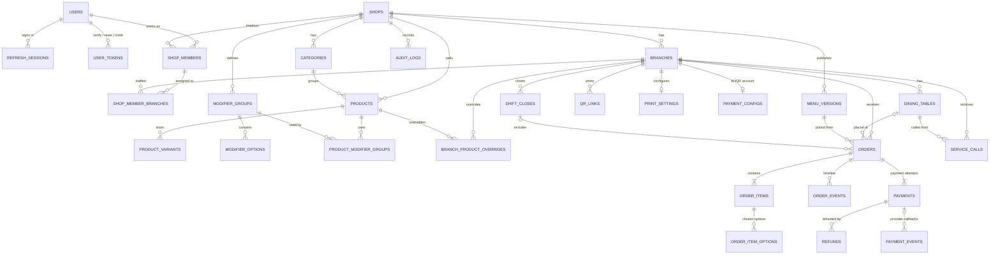
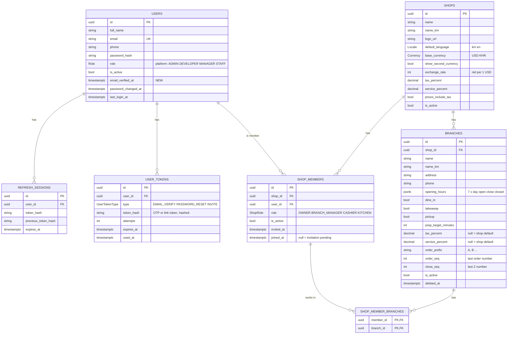
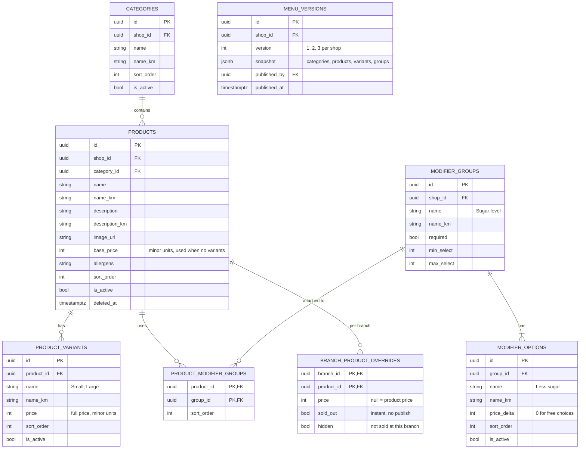
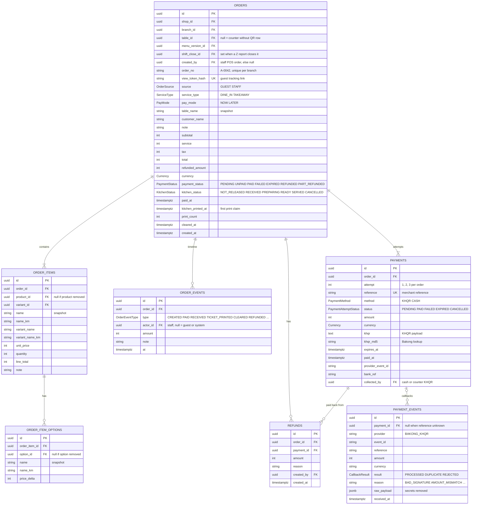
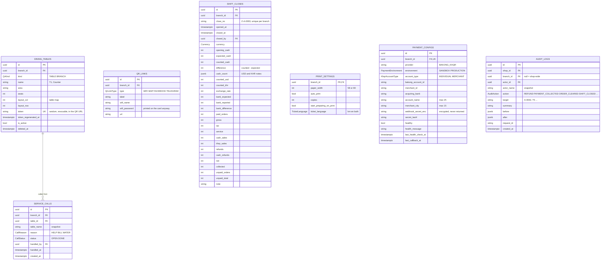

# E-Menu — Frontend feature review & database design

Source reviewed: `../core-system-next-ts-main` (package `qr-restaurant-admin`, Next.js 16), commit `ab852fa`.
The frontend runs on mock data (`USE_MOCK = true`); its `core/model.ts` files and the mock backend
`components/modules/order/core/server.ts` define what this API must store and enforce.

Status: **design only** — `prisma/schema.prisma` is not changed yet.

---

## 1. Frontend features (what the database must support)

| Area | Pages | What it does | Data it needs |
|---|---|---|---|
| Auth | `/auth/sign-in`, `/sign-up`, `/sign-up/verification`, `/forgot-password` | Email + password login, register with email OTP, password reset | users, sessions, one-time tokens |
| Roles | (everywhere) | `owner`, `branch_manager`, `cashier`, `kitchen` (+ platform `super_admin`); capability matrix in `constants/permissions.ts`; non-owners locked to their branches | shop membership + member branches |
| Shop profile | `/shop/profile` | Name km/en, logo, default language, base currency USD/KHR, show 2nd currency + exchange rate, tax %, service %, prices include tax | shops |
| Branches | `/shop/branches` | Name km/en, address, phone, opening hours per weekday, dine-in/takeaway/pickup, prep target, tax/service override, active | branches |
| Staff | `/shop/staff` | Invite by email/phone, one role, list of branches, active, "joined" | shop_members, shop_member_branches, user_tokens (invite) |
| Menu | `/menu`, `/menu/categories`, `/menu/products` (+new/[id]), `/menu/modifiers` | Categories; products with image, km/en text, base price, size variants, modifier groups, allergens, sort; modifier groups (required, min/max) with options (price delta); per-branch price / sold-out / hidden | categories, products, product_variants, modifier_groups, modifier_options, product_modifier_groups, branch_product_overrides |
| Menu publish | `/menu/publish` | Validate → publish an immutable numbered version; guests order from the latest | menu_versions (JSON snapshot) |
| Tables & QR | `/qr/tables`, `/qr/print` | Tables per branch (table QR or one branch/counter QR), area, seats, map position, random revocable token; print presets; extra QR cards (WiFi, Maps, Facebook, Telegram) | dining_tables, qr_links |
| Guest app | `/m/[token]`, `/cart`, `/order/[viewToken]` | Resolve token → branch + table + menu, cart, checkout pay now (KHQR) or pay later, live order tracking by view token, "Call staff" (help / bill / water, 30 s cooldown) | orders, order_items, payments, service_calls |
| Orders / table map | `/orders` | Live orders per table, ticket printing (first claim wins, reprint), collect cash / counter KHQR, clear when guests leave | orders, order_events, payments |
| POS | `/orders/new` | Staff order at counter/table → kitchen at once as UNPAID | orders (source = STAFF) |
| Order history | `/orders/all` | Search/filter all orders | orders (+ indexes) |
| Payments | `/payments`, `/payments/accounts` | Transactions, refunds; Bakong KHQR account per branch (write-only webhook secret, health) | payments, refunds, payment_events, payment_configs |
| Close shift | `/close-shift` | Z report: count USD + KHR notes, expected vs counted cash, bank expected vs reported, frozen record | shift_closes (+ orders.shift_close_id) |
| Reports | `/reports/sales`, `orders`, `payments`, `products`, `branches`, `closings` | All computed from paid orders, refunds and closes (revenue = paid − refunds) | no extra tables; indexes on orders/payments/refunds |
| Printing | (Orders page) | Per-branch thermal printer settings: 58/80 mm, auto print, copies, start preparing on print, ticket language | print_settings |
| Audit | (no page, still recorded) | Who did what: refunds, payment collected, QR regenerate, publish, sold out, staff role, order cleared, shift closed… | audit_logs |

### Business rules the database must make safe
1. **Server pricing.** Checkout sends only choices (`productId`, `variantId`, `optionIds`, `quantity`, `note`); the API prices them from the published menu + branch overrides (`menu/core/pricing.ts`). Service charge first, then tax on (subtotal + service), or tax included.
2. **Payment state ≠ kitchen state.** Two separate columns, never merged (`paymentStatus`, `kitchenStatus`). Staff see a short stage derived from both: Pending → Unpaid → Paid → Clear.
3. **One payment reference per checkout attempt**, with exact amount and 10-minute expiry. A retry creates a new attempt; old attempts stay.
4. **Callbacks:** verify signature → match reference + amount + currency → deduplicate by provider event id → in **one transaction** mark paid + release to kitchen + log the event.
5. **Refunds never edit the payment**; they are separate rows. `refunded_amount ≤ total`.
6. **Snapshots:** order lines copy names, variant, options and prices; a shift close freezes its totals.
7. **Ticket printing:** the first station to claim the ticket prints (`kitchen_printed_at` set once).
8. **Money** in integer minor units (USD cents, KHR riel). Revenue counts PAID orders only.

### Review findings (frontend ↔ API gaps)
| # | Finding | Impact | Recommendation |
|---|---|---|---|
| F1 | Frontend models use `_id`; this API returns `id` | Every screen breaks when mocks are switched off | Map `id → _id` in the frontend axios layer (one place), or agree on one name now |
| F2 | Frontend roles (`owner`, `branch_manager`, `cashier`, `kitchen`) ≠ API `Role` enum (`ADMIN`, `DEVELOPER`, `MANAGER`, `STAFF`) | Login works, permissions don't | Keep `users.role` for **platform** access; add `shop_members.role` (`ShopRole`) for restaurant roles |
| F3 | `orderNo` prefix is hard-coded in the mock (`branchId.includes("river") ? "B" : "A"`) | Wrong numbers with real branches | `branches.order_prefix` + an atomic per-branch counter |
| F4 | Menu versions are shop-wide; branch overrides apply instantly without publishing | Overrides must not live inside the snapshot | `branch_product_overrides` table, read live at checkout |
| F5 | Register / verify OTP / forgot password pages exist; the API has none of these endpoints | Sign-up can't work | `user_tokens` table + endpoints |
| F6 | One-row `app_settings` vs a SaaS with many shops (`super_admin`, "cross-tenant access fails safely") | Single tenant only | `shops` table as the tenant; every business row carries `shop_id` |
| F7 | Guest view token and QR token are bearer secrets in URLs | Leaked DB = trackable orders | Store `view_token_hash` (SHA-256); QR token stays plain (it is printed publicly) but long and random |
| F8 | Webhook secret is a constant in the mock | — | Store encrypted (`webhook_secret_enc`), return only `secret_last4` |
| F9 | `docs/mvp-plan.md` still says "plan only, nothing built" | Misleading | Update the doc |

---

## 2. Design decisions

| Decision | Choice | Why |
|---|---|---|
| Tenant | `shops` row = one restaurant business; all business tables have `shop_id` | SaaS, cross-tenant isolation, per-shop reporting |
| People | Global `users` (login) + `shop_members` (role in a shop) + `shop_member_branches` | Same person can work for a shop in several branches; platform admins keep `users.role` |
| IDs | `uuid` everywhere (matches existing tables) | Not guessable, safe in URLs |
| Money | `Int` minor units + `currency` enum (`USD`, `KHR`) | Frontend decision D5; no float errors |
| Percentages | `Decimal(5,2)` | 10.00 %, 2.50 % exact |
| Languages | `name` + `name_km` columns (and `description_km`) | The UI is fixed to km/en; simple and fast. Move to a translations table only if a 3rd language comes |
| Opening hours, cash count, menu snapshot | `jsonb` | Always read/written as a whole; validated by DTOs |
| Menu versions | Immutable JSON snapshot per publish; orders keep `menu_version_id` | Guests always order from one consistent menu; history is exact |
| Order timeline | `order_events` rows (append-only) | Audit-quality history; replaces the `timeline[]` array |
| Payment attempts | `payments` table (1 order → many attempts) | Retries, counter KHQR, cash; references unique |
| Deletes | `active` flags / `deleted_at` on things orders reference (branches, products, tables); `Restrict` FKs from orders | Past orders and reports never break |
| Counters | `branches.order_seq` / `close_seq` incremented with `UPDATE … RETURNING` | Gap-free per-branch numbers without races |

---

## 3. Entity-relationship diagrams

### 3.1 Overview (all tables)

### 3.2 Tenant, people and access

Constraints: `shop_members (shop_id, user_id)` unique; `branches (shop_id, order_prefix)` unique.
OWNER members ignore `shop_member_branches` (see every branch).

### 3.3 Menu

Constraints: `menu_versions (shop_id, version)` unique; `categories → products` **Restrict** (can't delete a
category with products); `product → variants/overrides/product_modifier_groups` **Cascade**;
`CHECK (min_select <= max_select)`, `CHECK (base_price >= 0)`.

### 3.4 Orders, payments and refunds

Constraints and indexes:
- `orders (branch_id, order_no)` unique; `orders.view_token_hash` unique.
- `payments (order_id, attempt)` unique; `payments.reference` unique.
- **Exactly-once callbacks:** partial unique index (raw SQL in the migration — Prisma can't express it):
  `CREATE UNIQUE INDEX payment_events_processed_uq ON payment_events (provider, event_id) WHERE result = 'PROCESSED';`
- `CHECK (refunded_amount BETWEEN 0 AND total)`, `CHECK (quantity > 0)`, `CHECK (amount > 0)` on refunds.
- Indexes for the screens and reports: `orders (branch_id, created_at)`, `orders (branch_id, payment_status)`,
  `orders (branch_id, kitchen_status)`, `orders (shop_id, paid_at)`, `payments (status, expires_at)` (expiry job),
  `refunds (order_id)`, `refunds (created_at)`, `order_items (product_id)` (product report).
- FKs from orders to branches, tables, products, options: **Restrict / SetNull** — never cascade-delete history.
  Order children (`order_items`, `order_events`, `payments`) cascade only with their order.

### 3.5 Tables, QR, service calls, shifts, printing, payment accounts, audit

Constraints: `dining_tables (branch_id, name)` unique among active rows; `shift_closes (branch_id, close_no)` unique;
`service_calls (table_id, status, created_at)` index (30-second cooldown check, open calls list);
`audit_logs (shop_id, created_at)` index; audit rows are insert-only.

---

## 4. Table list (32 tables: 5 existing + 27 new)

| Group | Tables |
|---|---|
| Existing (keep) | `users`, `refresh_sessions`, `permissions`, `role_permissions`, `app_settings` |
| Identity | `user_tokens` |
| Tenant & staff | `shops`, `shop_members`, `shop_member_branches`, `branches` |
| Menu | `categories`, `products`, `product_variants`, `modifier_groups`, `modifier_options`, `product_modifier_groups`, `branch_product_overrides`, `menu_versions` |
| Floor & QR | `dining_tables`, `qr_links`, `service_calls`, `print_settings` |
| Orders & money | `orders`, `order_items`, `order_item_options`, `order_events`, `payments`, `refunds`, `payment_events`, `payment_configs` |
| Operations | `shift_closes`, `audit_logs` |

`users.role` + `permissions/role_permissions` stay for **platform** staff (the people who run the SaaS).
Restaurant staff get their access from `shop_members.role`; the API maps `ShopRole` to the frontend's
capability matrix (`constants/permissions.ts`).

## 5. Suggested build order (migrations)
1. ✅ `shops`, `branches`, `shop_members`, `shop_member_branches`, `user_tokens` (+ `users.email_verified_at`)
   — migration `20261118031255_step1_shops_branches_staff` (includes CHECK constraints).
2. Menu tables + `menu_versions`.
3. `dining_tables`, `qr_links`, `print_settings`.
4. `orders`, `order_items`, `order_item_options`, `order_events`, `payments`, `refunds`, `payment_events`, `payment_configs` (+ the partial unique index).
5. `service_calls`, `shift_closes`, `audit_logs`.

Each step: `npx prisma migrate dev --create-only --name <step>` → review SQL → `npm run db:migrate`.
